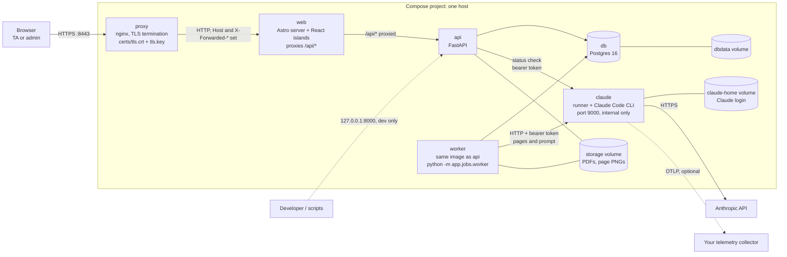
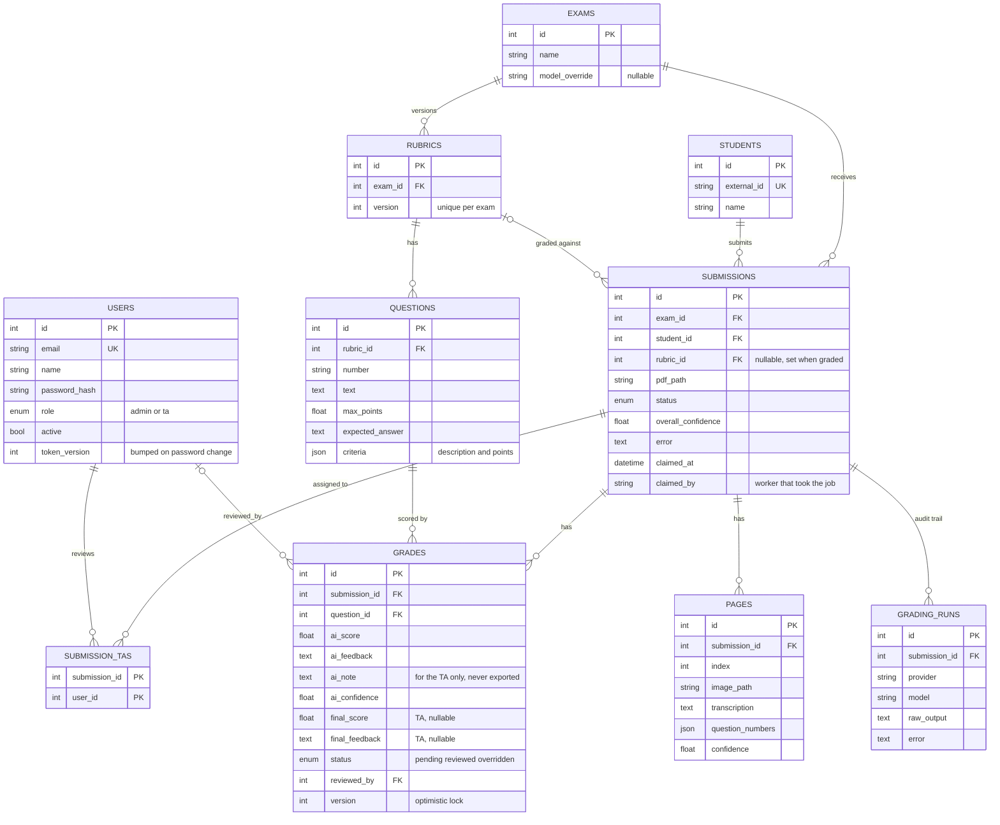
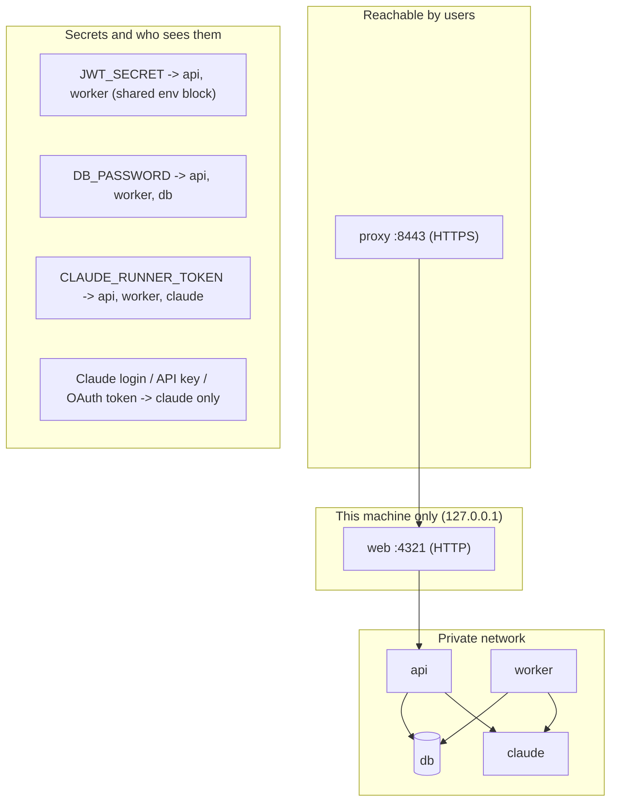

# Architecture

## What the system does

TAs verify AI-graded, scanned answer sheets. An admin defines a rubric and imports PDFs. Claude transcribes
each page, works out which questions appear on it, grades every question with feedback, and reports a
confidence for each page and each grade. TAs then approve or edit those grades; their edits are stored
separately so the AI's original output is always kept.

## Components



| Service | Image / code | Responsibility | Holds |
|---|---|---|---|
| `web` | `web/` (Astro 5, Node adapter, React 18 islands) | Pages, login redirect, role gate for `/admin`, same-origin proxy `/api/*` → `api` | nothing secret |
| `api` | `api/` (FastAPI, SQLAlchemy 2, Alembic) | Auth, exams/rubrics, import, review, export. Runs migrations on start, creates the bootstrap admin | `JWT_SECRET`, DB password, runner token |
| `worker` | same image as `api` | Claims queued papers, renders pages, calls the grader, validates and stores results; recovers stale jobs | DB password, runner token (also `JWT_SECRET` and the bootstrap password, see below) |
| `claude` | `claude/Dockerfile` (Python + Node + Claude Code CLI) | Runs `claude -p` on request, owns the Claude login | Claude credentials, runner token |
| `db` | `postgres:16` | All state, and the job queue | data |

The `api` and `worker` containers never see Claude credentials: `docker-compose.yml` passes them an explicit
list of variables (`x-app-env`) instead of `env_file`. Limitation: both share that one block, so the worker
also receives `JWT_SECRET` and the bootstrap admin password, which it never uses. Splitting the block would
tighten this.

## Code map

```
api/app/
  main.py            app, CORS, bootstrap admin, routers
  config.py          Settings (env vars)
  db.py, models/     SQLAlchemy engine/session, all tables
  auth/              password hashing, JWT cookie, current_user, require_admin
  routes/            auth, exams, submissions, imports, grading, review
  pdf/               PyMuPDF helpers under a global lock: page_count, extract_ranges, render_pages
  storage/           Storage protocol + LocalStorage (path-traversal guarded)
  grader/            base (contracts, check_result, retry), claude_cli (providers/executors),
                     fake, anthropic_api (stub), __init__ (registry)
  jobs/              queue.py (claim/process/recover), worker.py (threads, signals)
  claude_runner.py   the runner served by the claude container
api/alembic/         migrations (0001_initial)
web/src/             pages/ (Astro), components/ (React), lib/api.ts, middleware.ts, pages/api/[...path].ts
claude/              Dockerfile, requirements.txt
scripts/             claude-login.sh, export-openapi.py
```

## Data model



Uniqueness: one submission per `(exam, student)`, one grade per `(submission, question)`, one rubric row per
`(exam, version)`.

## Design decisions

| Decision | Why | Where |
|---|---|---|
| **AI output is immutable**: Claude writes `ai_*`, TAs write `final_*` | Disagreements stay measurable; a bad edit never destroys the original | `models`, `routes/review.py` |
| **Rubrics are versioned**, never edited in place | A grade stays traceable to the exact rubric used; regrading is explicit | `routes/exams.py` |
| **Several TAs per paper** via `submission_tas`; grade rows are shared | Double-marking without duplicating grades | `models`, `routes/submissions.py` |
| **Optimistic lock on grades** (`version`) | Two TAs can't silently overwrite each other; loser gets a 409 with the current value | `routes/review.py` |
| **Postgres is the queue** (`status='queued'` + `SKIP LOCKED`) | No extra service; fine for classroom volumes. Crash recovery: a restarted worker requeues its own jobs at once (`claimed_by`), anyone else's after a timeout (`claimed_at`) | `jobs/queue.py`, `jobs/worker.py` |
| **Roles are read from the database on every request**, not stored in the cookie | Role changes, deactivation and deletion take effect immediately on live sessions | `auth/__init__.py`, `routes/auth.py` |
| **Sessions carry a `token_version`**; a password change bumps it | The cookie is a stateless signed token, so this is how a changed or reset password ends the account's other sessions. Tokens issued before the field existed count as version 0 and stay valid until the first change | `auth/__init__.py`, `routes/auth.py` |
| **Password policy is enforced on the server** (8+ chars, at most 72 bytes) for create, change and reset | bcrypt silently ignores bytes past 72, so longer passwords are rejected rather than truncated | `routes/auth.py` |
| **Admins can't reset their own password through the reset route** | Changing your own needs the current password, so a hijacked admin session can't silently take the account over | `routes/auth.py` |
| **Deleting a user never deletes papers or grades** | Assignments are removed and `reviewed_by` is cleared (only with `force`); deactivation is the history-preserving alternative. The last active admin and yourself are protected | `routes/auth.py` |
| **`GraderProvider` template method** | A new backend implements one method (`_attempt`); validation, retry-with-feedback and persistence are shared | `grader/base.py` |
| **`ClaudeExecutor` protocol** (`LocalExecutor` / `RemoteExecutor`) | Same provider runs the CLI in-process (dev) or in the dedicated container (default) | `grader/claude_cli.py` |
| **The runner owns the CLI flags** | A leaked runner token can't be used to give Claude shell access; flags are fixed (`build_command`): read-only `Read` tool, confined to the temp dir, no prompts, no session saved | `grader/claude_cli.py`, `claude_runner.py` |
| **Prompt-injection stance** | Student text is treated as data; the prompt says so and asks for lowered confidence if a paper tries to instruct the grader | `grader/claude_cli.py: PROMPT` |
| **Browser → Astro → API proxy** | Same-origin cookie (no CORS), API not public, one TLS endpoint | `web/src/pages/api/[...path].ts` |
| **Deleting is explicit and guarded**: papers and exams can be deleted by admins; anything holding TA-reviewed work needs `force`, a paper being graded can never be deleted, and rows are locked (`FOR UPDATE`) between the check and the delete so a worker can't claim one in between | Prevents a worker writing results for a paper that no longer exists, and accidental loss of review work. Files are removed after the commit, best effort | `deletion.py`, `routes/submissions.py`, `routes/exams.py` |
| **A TA only sees exams they are assigned to**: `GET /exams` and the rubric are filtered on the server, not just hidden in the UI | Exam names and model answers are not exposed to TAs who don't grade them; the exam selector follows assignments automatically | `routes/exams.py: visible_exams` |
| **Table search is client-side** (`web/src/lib/search.ts`): all terms must match, case- and accent-insensitive | Lists are classroom-sized and already loaded; it is instant and needs no API. Revisit with server-side search/pagination if a list reaches thousands of rows | `web/src/components/SearchBox.tsx` |
| **The cross-site check is our own and configured at runtime** (`ALLOWED_HOSTS`), not Astro's build-time one | A published Docker image can't know the deployer's hostname at build time; this makes one image work everywhere. The rule is the same as Astro's, with a host allow-list added, and is unit tested | `web/src/lib/csrf.ts`, `web/src/middleware.ts` |
| **404 instead of 403** for papers you can't see | Doesn't reveal which ids exist | `routes/submissions.py` |
| **Auto-split reads contact sheets, not pages** | One model round-trip per page made a 158-page PDF take minutes and overflow the context. The top of ~6 pages per image, all in one message with no tools, takes about half a minute; very long PDFs go in overlapping chunks | `pdf/__init__.py: contact_sheets`, `grader/claude_cli.py: propose_split`, `grader/base.py: merge_chunk_splits` |
| **One global lock around PyMuPDF** | PyMuPDF is not thread-safe; worker threads and API threadpool both use it | `pdf/__init__.py` |
| **`Storage` protocol** | Local disk now; S3-style backend later without touching callers | `storage/__init__.py` |
| **Confidence is a triage signal** | It is the model's self-estimate, not calibrated; the queue sorts by it, nothing is auto-approved | `web/src/components/Queue.tsx` |

## Trust boundaries



- Only the **`proxy`** (nginx, HTTPS) is published on the network. `web` (`127.0.0.1:4321`) and `api`
  (`127.0.0.1:8000`) are bound to loopback for development only; `claude` has no published port.
- **Native mode** (`./run.sh --native`) runs api, worker, web and a Node TLS proxy as plain processes with SQLite. The
  schema, migrations and application code are the same; only the engine settings (`app/db.py: make_engine`) and the job
  claim (`jobs/queue.py: _claim_sqlite`, a conditional UPDATE instead of `SKIP LOCKED`) differ.
- **Sign-in:** password, and optionally Google (OpenID Connect, authorization code + PKCE). Google only identifies
  someone who already has an account; it never creates one. A user with no password (blank, set by an admin) can only
  use Google.
- Student work is sent to Anthropic (via Claude) for grading. Telemetry, if enabled, exports usage metrics
  but not prompt text.
- Untrusted input surfaces: uploaded PDFs/CSV (validated, size-limited, never used as file paths), page
  content (treated as data), runner requests (authenticated, validated file names/model).
