# Workflows and flowcharts

Diagrams are [Mermaid](https://mermaid.js.org/); they render on GitHub, GitLab and in VS Code.
Source files are named next to each diagram so you can check them against the code.

1. [End-to-end lifecycle](#1-end-to-end-lifecycle)
2. [Submission states](#2-submission-states)
3. [Import decision flow](#3-import-decision-flow)
4. [Grading pipeline](#4-grading-pipeline)
5. [Review and edit conflicts](#5-review-and-edit-conflicts)
6. [Request path and authentication](#6-request-path-and-authentication)
7. [Claude login and readiness](#7-claude-login-and-readiness)
8. [Restarts and recovery](#8-restarts-and-recovery)

---

## 1. End-to-end lifecycle

Who does what, from an empty system to an exported gradebook.

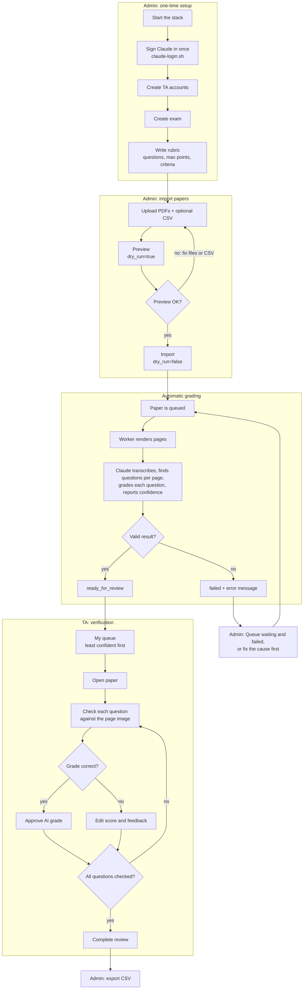

Notes:
- Papers imported **before** a rubric exists stay `uploaded`; use *Queue waiting & failed* on the exam's
  Papers tab (`POST /exams/{id}/queue`) after saving the rubric.
- An admin can regrade any finished paper later (see [state diagram](#2-submission-states)).

---

## 2. Submission states

`Submission.status` (`api/app/models/__init__.py`). A submission in `queued` *is* a pending job; there is
no separate queue table.

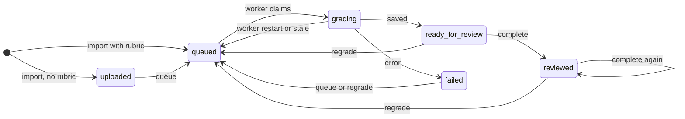

Rules behind the arrows:

| Transition | Where | Condition |
|---|---|---|
| import → `queued` / `uploaded` | `routes/imports.py` | `queued` only if the exam already has a rubric |
| `queued` → `grading` | `jobs/queue.py: claim_next` | `SELECT … FOR UPDATE SKIP LOCKED`, oldest id first; sets `claimed_at` |
| `grading` → `queued` (worker restarted) | `jobs/queue.py: recover_own` | At worker start-up: jobs this worker (`claimed_by` = its container hostname or `WORKER_ID`) had claimed. Immediate |
| `grading` → `queued` (stale) | `jobs/queue.py: recover_stale` | Anyone's job with `claimed_at` older than `GRADER_TIMEOUT_SECONDS × GRADER_MAX_ATTEMPTS + 120 s`; checked every minute |
| `grading` → `failed` | `jobs/queue.py: _fail` | any exception; message stored in `submission.error` and a `GradingRun` row |
| → `reviewed` | `routes/review.py: complete_review` | at least one grade and none `pending`, otherwise 409 |
| regrade | `routes/grading.py: regrade` | 409 if `queued`/`grading`; 409 if any grade is `reviewed`/`overridden` unless `force=true` |

A **grade** has its own small lifecycle: `pending` (Claude's suggestion, unchecked) → `reviewed` (TA saved
values identical to Claude's) or `overridden` (TA changed score or feedback). TAs can edit grades only while
the submission is `ready_for_review` or `reviewed`.

---

## 3. Import decision flow

`POST /exams/{exam_id}/imports` (`api/app/routes/imports.py`). Always preview with `dry_run=true` first;
the same request with `dry_run=false` commits.

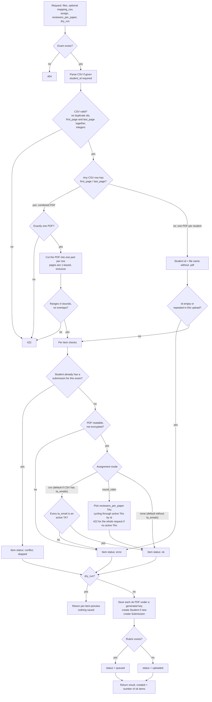

Details worth knowing:
- Item-level problems never fail the whole batch; only request-level problems (bad CSV, bad ranges) return 422.
- Stored file names are server-generated (`submissions/{exam}/{uuid}.pdf`); uploaded names are never used as paths.
- If saving fails part-way, the database transaction is rolled back and already-written files are deleted.
- Each file is limited by `MAX_UPLOAD_MB` (413 when exceeded).

---

## 4. Grading pipeline

What happens to one `queued` submission (`api/app/jobs/queue.py`, `api/app/grader/*`, `api/app/claude_runner.py`).

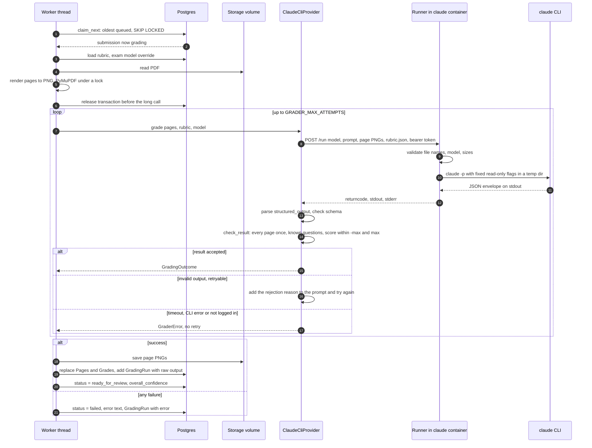

Design points:
- **Only the `claude` container has the CLI and the credentials.** The runner builds the CLI flags itself
  (`build_command` in `grader/claude_cli.py`); a caller can choose the model and send files but cannot add
  flags such as shell access.
- **Retries are for bad output, not for infrastructure.** Schema or consistency problems are retryable and
  the reason is fed back to the model; timeouts, non-zero exits and `is_error` results fail immediately.
- **No open transaction during the model call**, which can take minutes.
- **Negative marking is allowed.** A question's score may be between minus `max_points` and `max_points`; the check
  in `check_result` rejects anything outside that, and a retryable rejection is fed back to the model.
- **Feedback and reviewer note are separate.** `feedback` is the layout the student sees; the optional `note` (stored as
  `ai_note`) is for the TA only and is never exported.
- **AI output is never overwritten by TAs**: it lands in `ai_*` columns; TA edits go to `final_*`.
- A regrade deletes the old `Page`/`Grade` rows and writes new ones; `GradingRun` rows accumulate as history.

---

### Auto-split of a combined PDF

`POST /exams/{id}/imports/auto-split` stages the PDF; a worker thread then runs `queue.process_split`
(`api/app/jobs/queue.py`, `grader/claude_cli.py: propose_split`, `pdf/__init__.py: contact_sheets`).

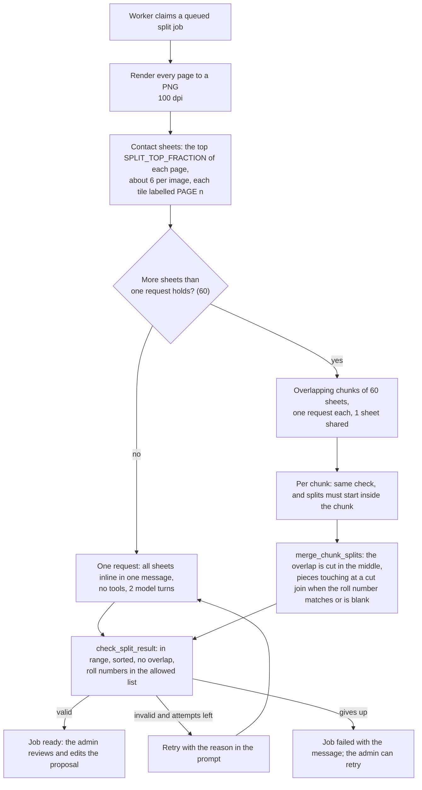

Why contact sheets in one message: the old approach told the CLI to open each page with its Read tool, one model round-trip
per page (160 for a 158-page scan, over two minutes even in a clean test and far longer under load, and past the context
window). Measured on a 158-page test PDF with Haiku: per-page reads 131 s and $0.25; all pages inline 32 s and $0.22;
contact sheets 26 s and a few cents.

## 5. Review and edit conflicts

Several TAs may be assigned to one paper. Each grade carries a `version`; an edit must quote the version it
read (compare-and-set in `routes/review.py: update_grade`).

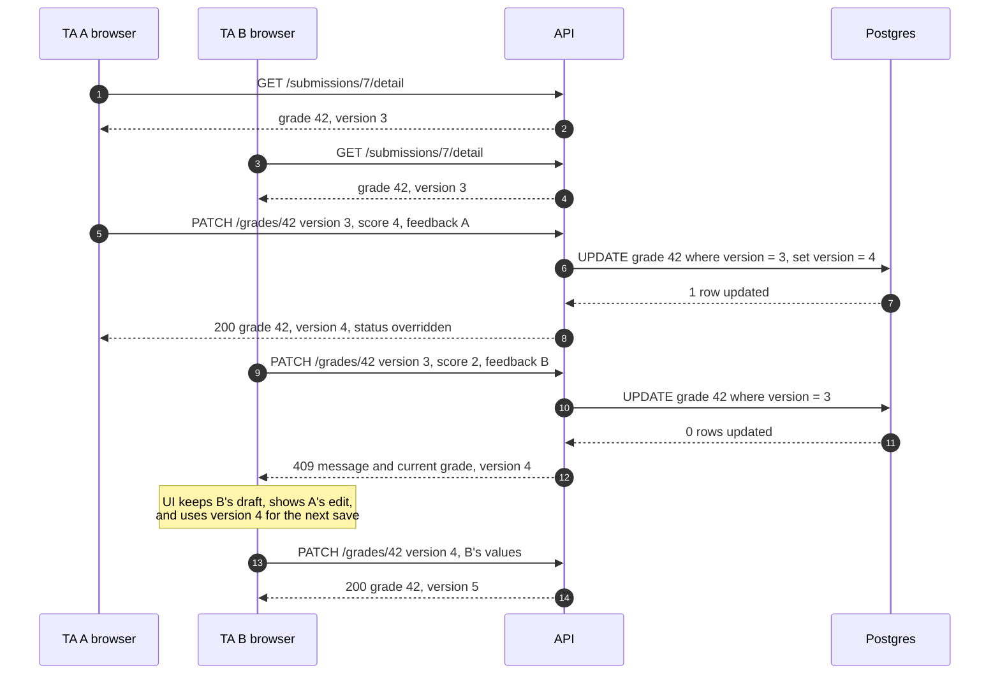

The edit rules:

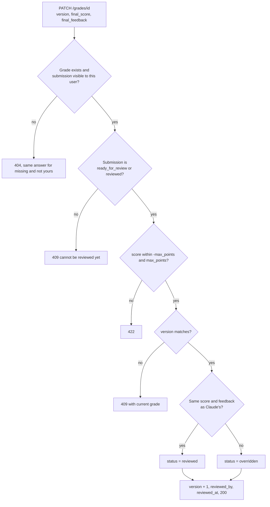

---

## 6. Request path and authentication

The browser only ever talks to the Astro `web` service. It serves pages and proxies `/api/*` to FastAPI over
the private network, so the session cookie is same-origin and the API need not be public.

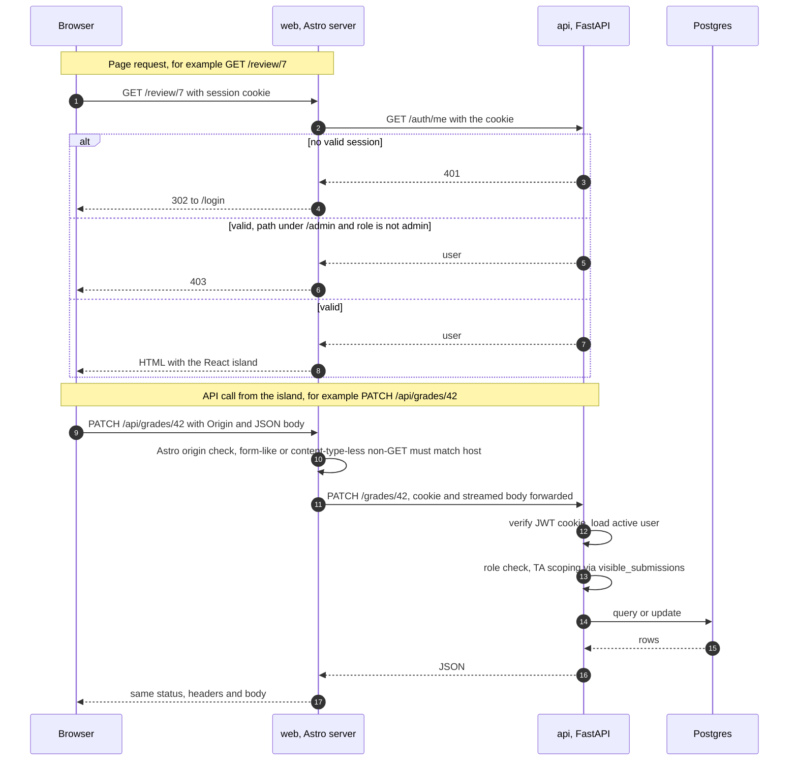

### Sign in with Google

Optional (`GOOGLE_CLIENT_ID`, `GOOGLE_CLIENT_SECRET`, `PUBLIC_BASE_URL`). It only signs in users an admin already created.

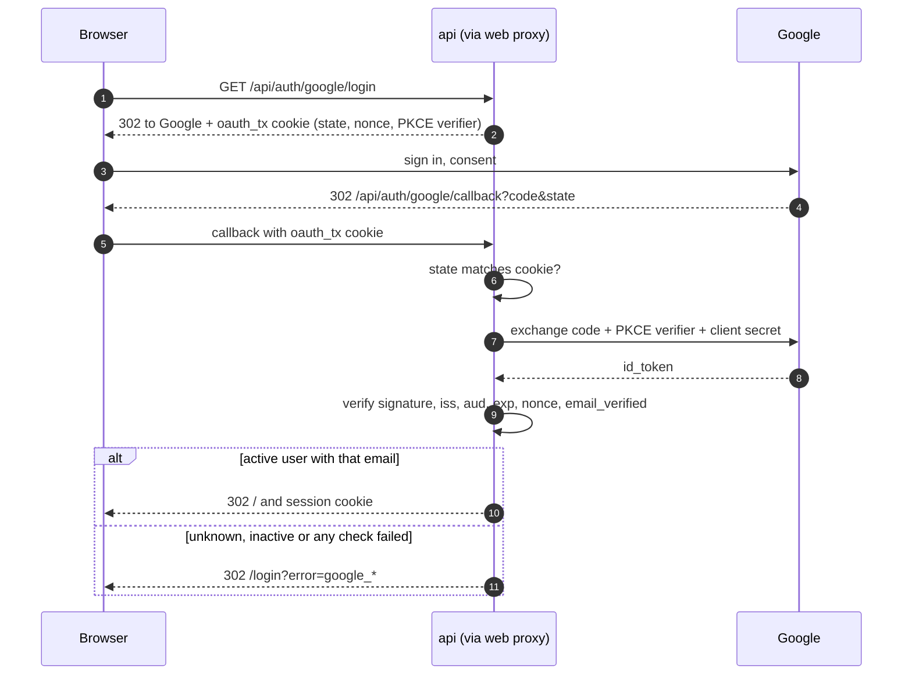

Authentication facts:
- Login sets an **HttpOnly, SameSite=Lax** cookie `session` holding an HS256 JWT (`JWT_SECRET`, lifetime
  `JWT_EXPIRE_MINUTES`); `Secure` is added when `COOKIE_SECURE=true`.
- **Roles:** `admin` (everything) and `ta` (only submissions they are assigned to). Scoping lives in one
  place, `visible_submissions` in `routes/submissions.py`. Inaccessible items return **404**, not 403.
- **Password changes end sessions.** Each user has a `token_version`, copied into the token as the claim `v` when it
  is issued. A change or admin reset bumps it, so every older token is rejected with 401. The session that made the
  change gets a fresh token and carries on. Role, active state and deletion are checked from the database on every
  request, so they apply immediately too.
- **CSRF:** SameSite=Lax plus an origin check in the web middleware (`web/src/lib/csrf.ts`). A write must carry an
  `Origin` naming the host the server was addressed with, and that host must be in `ALLOWED_HOSTS`, which is read at
  runtime (see [how-it-runs.md](how-it-runs.md#allowed_hosts)). Form-like and content-type-less writes are held to
  this; JSON is not, because a cross-site page can't send it without a CORS preflight the server never approves.
  Body-less POSTs from the UI send `Content-Type: application/json` for that reason.

---

## 7. Claude login and readiness

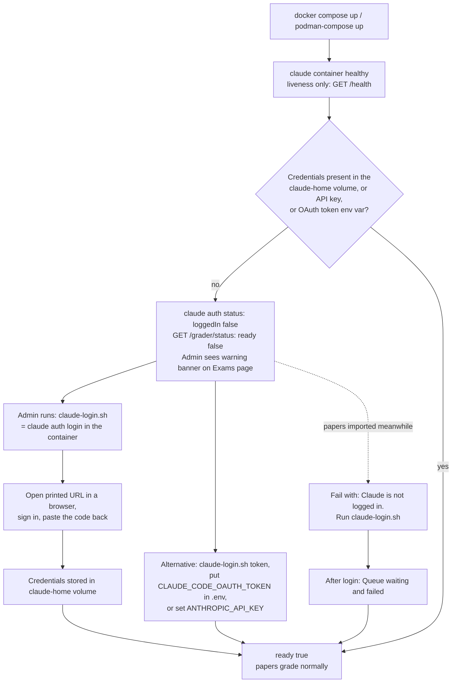

How readiness is computed: the API asks the provider (`GET /grader/status`, admin only) → the runner's
authenticated `GET /status` → `claude auth status --json`. It is *ready* if `loggedIn` is true **or**
`ANTHROPIC_API_KEY` is set in the container. A grading attempt without a login fails with a message that
names the fix instead of an empty error.

---

## 8. Restarts and recovery

What happens when the host, the container engine or a single container goes down and comes back. Data lives in
named volumes, so it is never in the container itself.

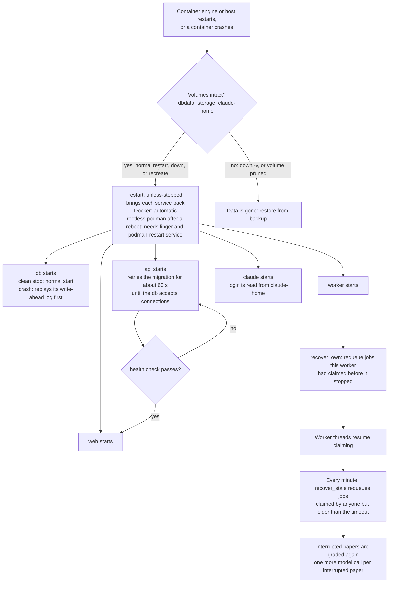

What this guarantees and what it doesn't:
- **Committed data survives** every case above, including a hard kill of Postgres (verified by killing it mid-write:
  no acknowledged row was lost).
- **A paper that was being graded is graded again.** Nothing is half-saved: results are written in one transaction
  at the end. The interrupted model call is paid for twice.
- **Unsaved work in a browser is lost** (a grade edit that was typed but not saved, an upload in flight).
- Shutdown behaviour is tuned so restarts are fast: Postgres gets `SIGINT` (fast shutdown) and `web` runs under an
  init process so it obeys `SIGTERM`.
